## Parte 1: Bases de Datos

### Consigna 01:

La base de datos propuesta es una base de datos relacional transaccional. Este tipo de bases se utilizan para registrar transacciones y se caracterizan por realizar muchas operaciones pequeñas de lectura y modificación sobre datos actuales, manteniendo una alta consistencia. En este caso, la función principal de la base es registrar y mantener actualizada la actividad cotidiana del centro de salud: altas y modificaciones de pacientes y médicos, consultas realizadas y recetas emitidas.Aunque el enunciado indica que también se desean obtener estadísticas de distribución demográfica, sexo y especialidad, esto no la convierte en un Data Warehouse/OLAP, ya que su propósito principal sigue siendo operar el sistema con información actual.

### Consigna 02:

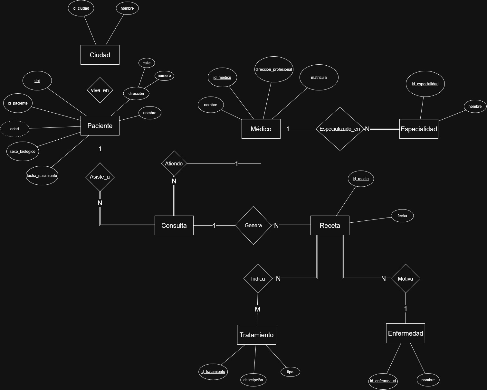

### Consigna 03:

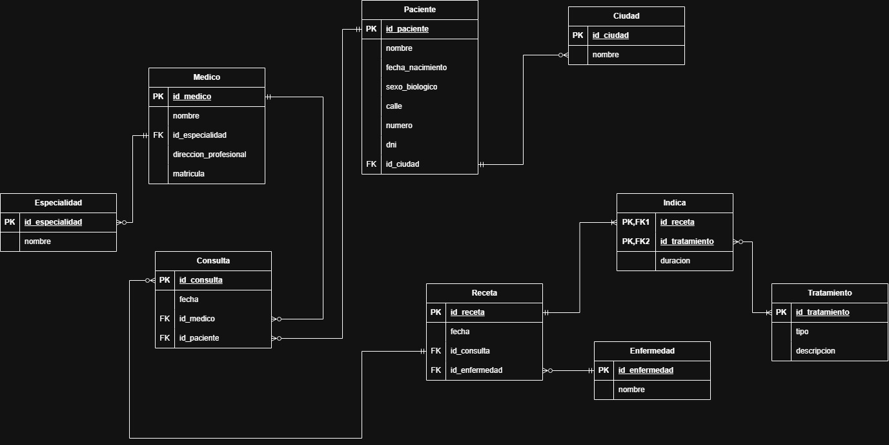

### Consigna 04:

Caso 1:
La forma normal que se viola en este caso es la primera, que indica que no debe haber valores atómicos en una misma celda. El culpable es la columna teléfono para la paciente Ana

Caso 2:
La forma normal que se viola en este caso es la tercera, que indica que no debe haber dependencias transitivas. La culpa la tiene como está escrito ciudad y código postal, que implica la cadena PacientID, Ciudad, Código Postal, pero código postal no depende del paciente, sino de Ciudad.

Caso 3:
La forma normal que se viola en este caso es la segunda, que indica que no debe haber dependencias parciales. Hay dos claves primarias y dos atributos, pero cada atributo está en una sola clave.

Caso 4:
La forma normal que se viola en este caso es la cuarta, que se cumple sí y solo síen cada dependencia multivaluada no trivial X ↠ Y, el conjunto X es una superclave. Acá, ambos medicamentos están repetidos para cada enfermedad, y la tabla se lee como si la diabetes se tratase con ibuprofeno y paracetamol. Lo correcto sería hacer una tabla con las enfermedades y otra con los medicamentos.


## Parte 2: SQL

### Consigna 01:

```sql
CREATE INDEX idx_pacientes_ciudad
ON Pacientes (ciudad);
```


### Consigna 02:

```sql
CREATE VIEW vista_pacientes_edad AS
SELECT
    p.id_paciente,
    p.nombre,
    p.fecha_nacimiento,
    EXTRACT(YEAR FROM AGE(CURRENT_DATE, p.fecha_nacimiento)) AS edad,
    s.descripcion AS sexo,
    p.ciudad
FROM Pacientes p
INNER JOIN SexoBiologico s ON p.id_sexo = s.id_sexo;
```

```sql
SELECT id_paciente, nombre, edad, sexo, ciudad
FROM vista_pacientes_edad;
```

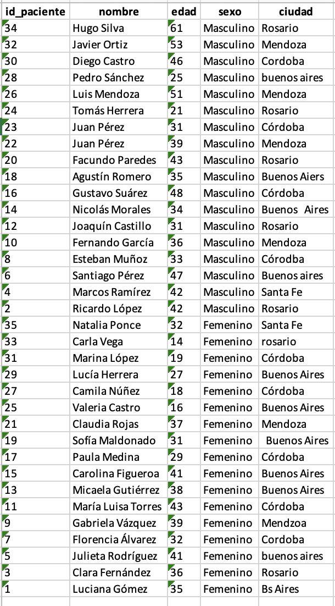

### Consigna 03:

```sql
SELECT nombre, edad
FROM vista_pacientes_edad
WHERE edad < 18;
```

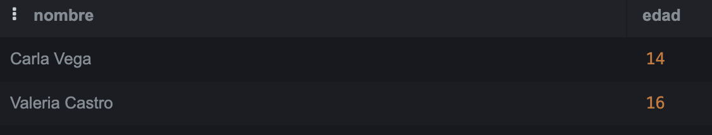

### Consigna 04:

```sql
SELECT id_paciente
FROM Pacientes
WHERE nombre = 'Luciana Gómez';
```

```sql
UPDATE Pacientes
SET numero = '500',
    calle  = 'Calle Corrientes',
    ciudad = 'Buenos Aires'
WHERE id_paciente = 1;
```
```sql
SELECT id_paciente, nombre, numero, calle, ciudad
FROM Pacientes
WHERE nombre = 'Luciana Gómez';
```
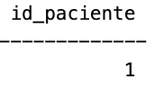


### Consigna 05:

```sql
SELECT nombre, calle, numero, ciudad
FROM Pacientes
WHERE ciudad ILIKE '%buenos%';
```
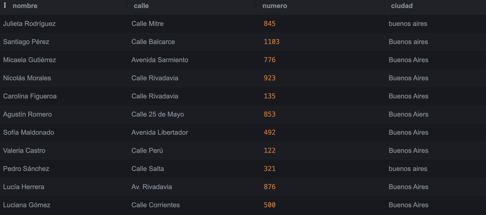

### Consigna 06:

```sql
SELECT DISTINCT ciudad
FROM Pacientes
ORDER BY ciudad;
```

```sql
UPDATE Pacientes
SET ciudad = 'Buenos Aires'
WHERE ciudad ILIKE '%buenos%'
   OR ciudad ILIKE 'bs%';


UPDATE Pacientes
SET ciudad = 'Córdoba'
WHERE ciudad ILIKE 'c%r%d%';


UPDATE Pacientes
SET ciudad = 'Mendoza'
WHERE ciudad ILIKE 'mend%';


UPDATE Pacientes
SET ciudad = 'Rosario'
WHERE ciudad ILIKE '%rosario%';
```

```sql
SELECT DISTINCT ciudad
FROM Pacientes
ORDER BY ciudad;
```
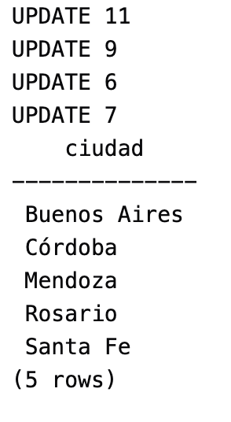

### Consigna 07:
```sql
SELECT p.ciudad, s.descripcion AS sexo, COUNT(*) AS cantidad_pacientes
FROM Pacientes p
INNER JOIN SexoBiologico s ON p.id_sexo = s.id_sexo
GROUP BY p.ciudad, s.descripcion
ORDER BY p.ciudad, s.descripcion;
```
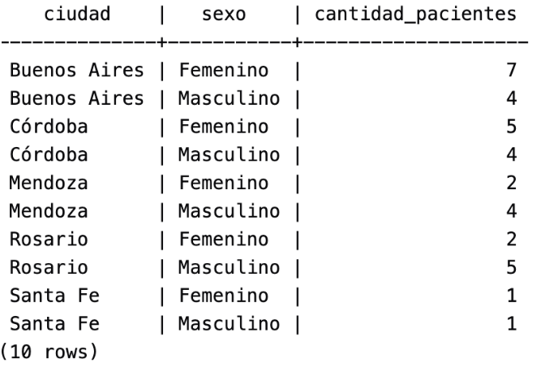

### Consigna 08:

```sql
SELECT *
FROM Consultas
WHERE id_medico = 3
  AND EXTRACT(YEAR FROM fecha) = 2024
  AND EXTRACT(MONTH FROM fecha) = 8;
```
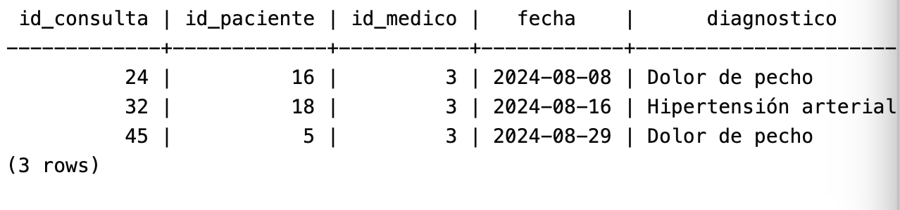

### Consigna 09:

```sql
SELECT m.nombre AS medico, COUNT(r.id_receta) AS cantidad_recetas
FROM Medicos m
INNER JOIN Recetas r ON m.id_medico = r.id_medico
GROUP BY m.nombre
ORDER BY cantidad_recetas DESC;
```
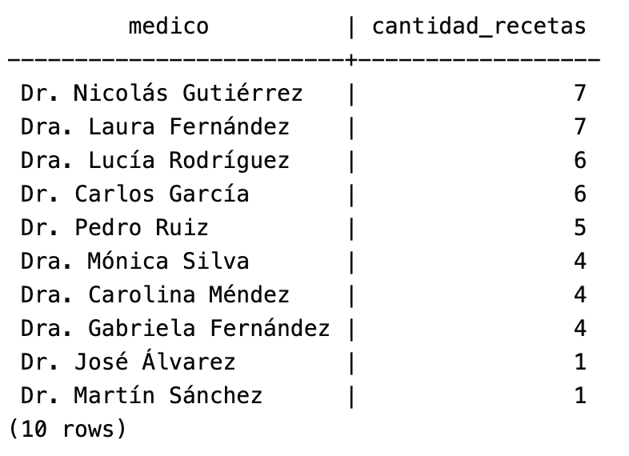

### Consigna 10:

```sql
SELECT p.nombre, c.fecha, c.diagnostico
FROM Consultas c
INNER JOIN Pacientes p ON c.id_paciente = p.id_paciente
WHERE EXTRACT(YEAR FROM c.fecha) = 2024
  AND EXTRACT(MONTH FROM c.fecha) = 8
ORDER BY c.fecha;
```
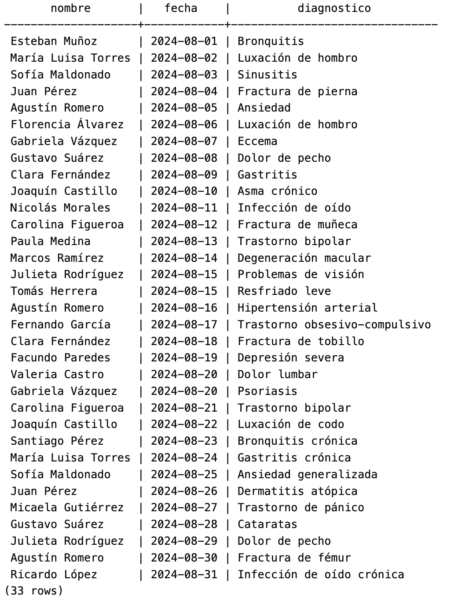

### Consigna 11:

```sql
SELECT m.nombre, COUNT(*) AS cantidad_recetas
FROM Recetas r
INNER JOIN Medicamentos m ON r.id_medicamento = m.id_medicamento
WHERE r.id_medico = 2
GROUP BY m.id_medicamento, m.nombre
HAVING COUNT(*) > 1;
```
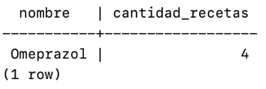


### Consigna 12:

```sql
SELECT p.nombre, COUNT(r.id_receta) AS cantidad_recetas
FROM Pacientes p
LEFT JOIN Recetas r ON p.id_paciente = r.id_paciente
GROUP BY p.id_paciente, p.nombre
ORDER BY p.nombre;
```
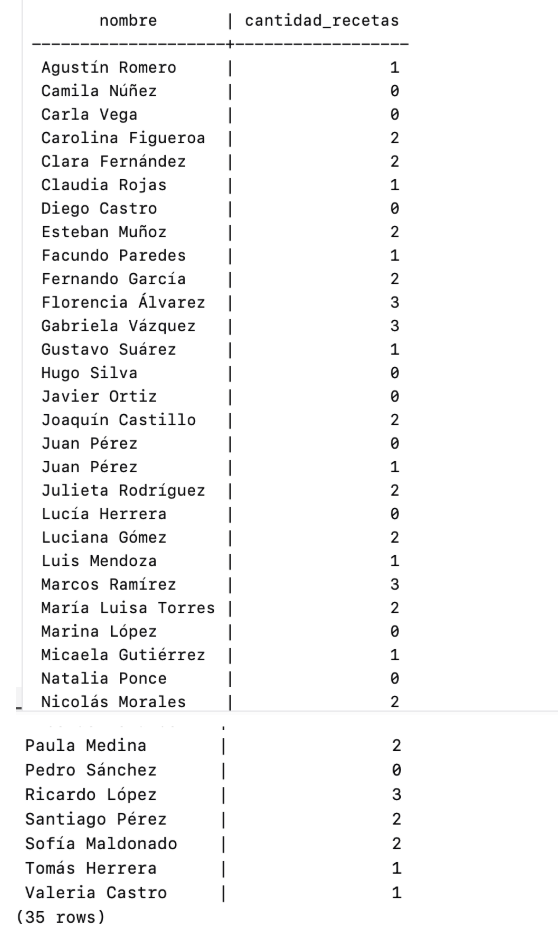

### Consigna 13:

```sql
SELECT e.nombre AS especialidad, COUNT(m.id_medico) AS cantidad_medicos
FROM Especialidades e
INNER JOIN Medicos m ON e.id_especialidad = m.especialidad_id
GROUP BY e.id_especialidad, e.nombre
HAVING COUNT(m.id_medico) > 2
ORDER BY cantidad_medicos DESC;
```
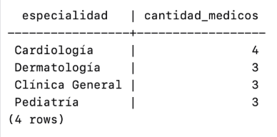

### Consigna 14:

```sql
SELECT nombre,
       EXTRACT(YEAR FROM AGE(CURRENT_DATE, fecha_nacimiento)) AS edad
FROM Pacientes
WHERE EXTRACT(YEAR FROM AGE(CURRENT_DATE, fecha_nacimiento)) >
      (SELECT AVG(EXTRACT(YEAR FROM AGE(CURRENT_DATE, fecha_nacimiento)))
       FROM Pacientes)
ORDER BY edad DESC;
```
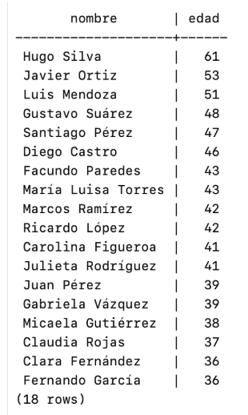

### Consigna 15:

```sql
SELECT m.nombre AS medicamento,
       COUNT(r.id_receta) AS cantidad_recetas
FROM Medicamentos m
INNER JOIN Recetas r ON m.id_medicamento = r.id_medicamento
GROUP BY m.id_medicamento, m.nombre
ORDER BY cantidad_recetas DESC
LIMIT 2;
```
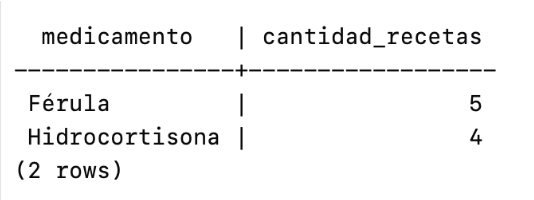

### Consigna 16:

```sql
SELECT p.nombre, c.fecha, c.diagnostico
FROM Pacientes p
INNER JOIN Consultas c ON p.id_paciente = c.id_paciente
WHERE c.fecha = (
    SELECT MAX(c2.fecha)
    FROM Consultas c2
    WHERE c2.id_paciente = p.id_paciente
)
ORDER BY p.nombre;
```
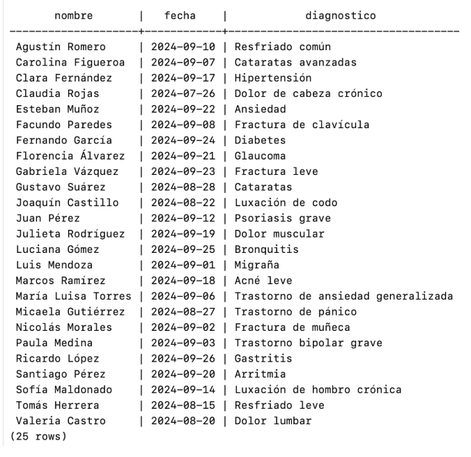

### Consigna 17:

```sql
SELECT m.nombre AS medico,
       p.nombre AS paciente,
       COUNT(c.id_consulta) AS total_consultas
FROM Consultas c
INNER JOIN Medicos m ON c.id_medico = m.id_medico
INNER JOIN Pacientes p ON c.id_paciente = p.id_paciente
GROUP BY m.id_medico, m.nombre, p.id_paciente, p.nombre
ORDER BY m.nombre, p.nombre;
```
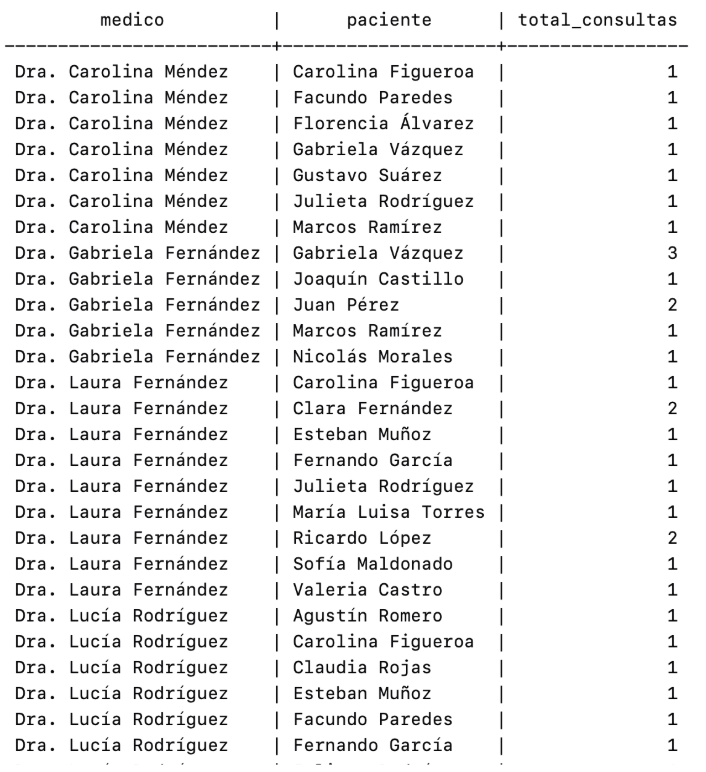
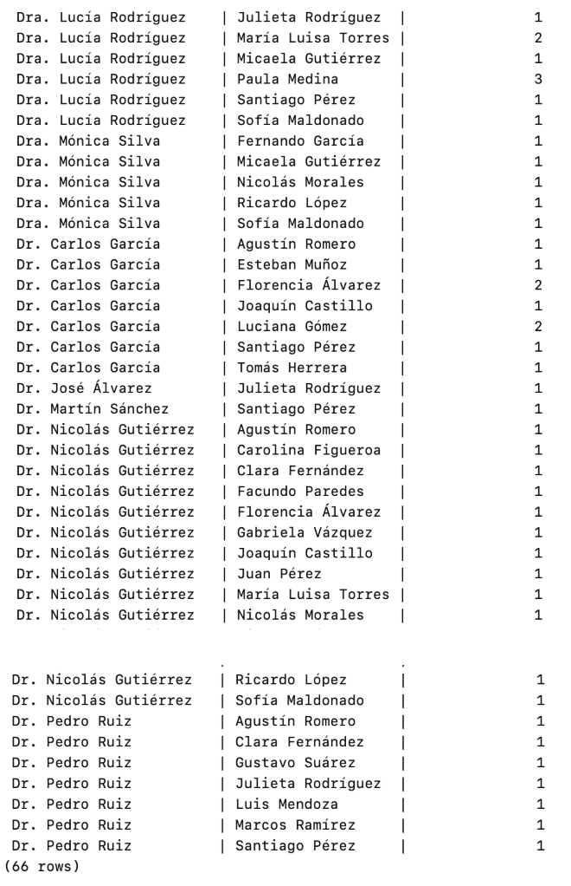

### Consigna 18:

```sql
WITH total_por_medicamento AS (
    SELECT id_medicamento, COUNT(*) AS total_recetas
    FROM Recetas
    GROUP BY id_medicamento
)
SELECT med.nombre AS medicamento,
       t.total_recetas,
       m.nombre AS medico,
       p.nombre AS paciente
FROM Recetas r
INNER JOIN Medicamentos med ON r.id_medicamento = med.id_medicamento
INNER JOIN Medicos m ON r.id_medico = m.id_medico
INNER JOIN Pacientes p ON r.id_paciente = p.id_paciente
INNER JOIN total_por_medicamento t ON r.id_medicamento = t.id_medicamento
ORDER BY t.total_recetas DESC, med.nombre, m.nombre, p.nombre;
```
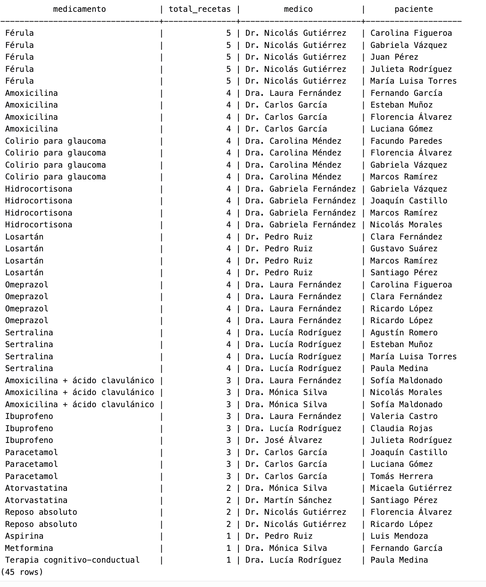

### Consigna 19:

```sql
SELECT m.nombre AS medico,
       COUNT(DISTINCT c.id_paciente) AS total_pacientes
FROM Medicos m
LEFT JOIN Consultas c ON m.id_medico = c.id_medico
GROUP BY m.id_medico, m.nombre
ORDER BY total_pacientes DESC;
```
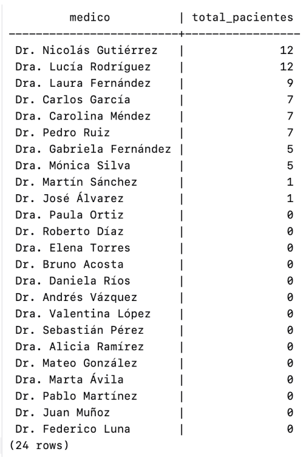

### Consigna 20:

```sql
SELECT m.nombre AS medico,
       COUNT(c.id_consulta) AS consultas_menores,
       CASE
           WHEN e.nombre = 'Pediatría' THEN TRUE
           ELSE FALSE
       END AS es_pediatra
FROM Medicos m
LEFT JOIN Especialidades e ON m.especialidad_id = e.id_especialidad
LEFT JOIN Consultas c ON m.id_medico = c.id_medico
   AND c.id_paciente IN (
       SELECT id_paciente
       FROM Pacientes
       WHERE EXTRACT(YEAR FROM AGE(CURRENT_DATE, fecha_nacimiento)) < 18
   )
GROUP BY m.id_medico, m.nombre, e.nombre
ORDER BY m.nombre;
```
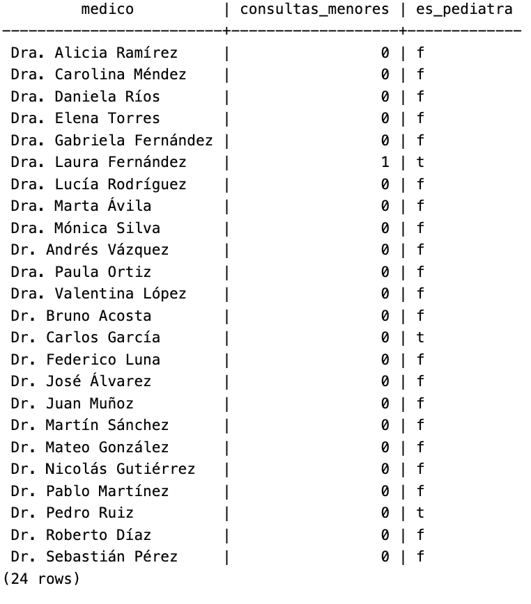
